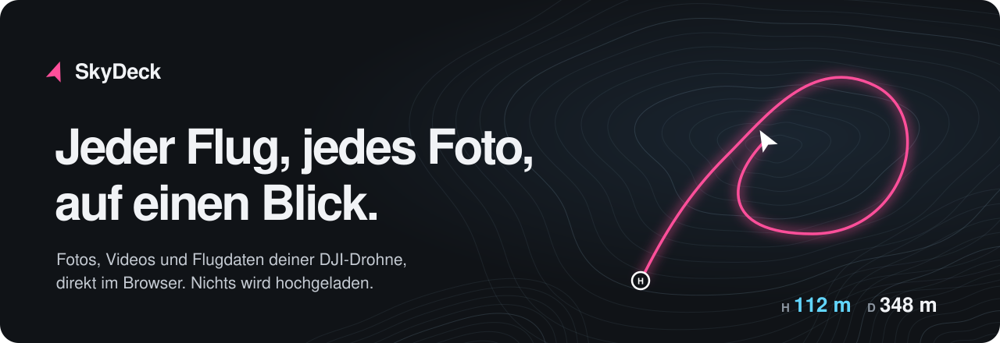
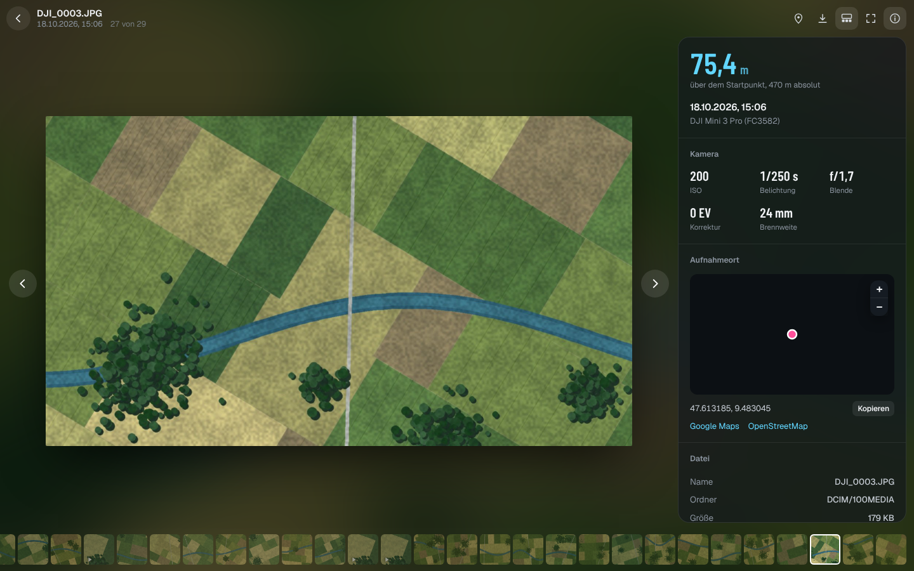
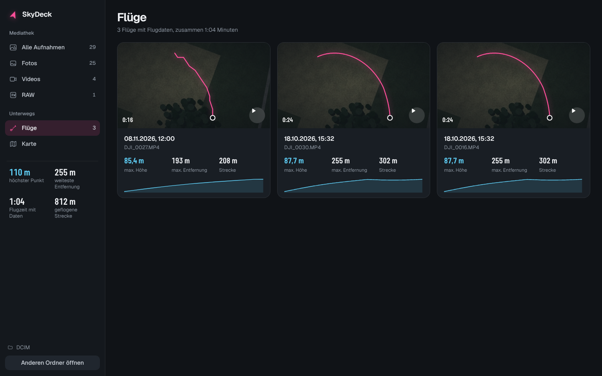

  

  

<h3 align="center"><a href="https://noahcool1604.github.io/skydeck/">noahcool1604.github.io/skydeck</a></h3>

Kostenlos, ohne Anmeldung, ohne Installation. Deine Fotos und Videos bleiben auf deinem Rechner.

 

## So geht's

1. **[SkyDeck öffnen](https://noahcool1604.github.io/skydeck/)**, am Computer oder Handy.
2. Auf **Ordner öffnen** klicken und den Ordner von der SD-Karte der Drohne wählen (meist `DCIM`). Oder den Ordner einfach ins Fenster ziehen.
3. Fertig. SkyDeck liest Fotos, Videos und Flugdaten direkt im Browser.

## Was SkyDeck kann

<table>
  <tr>
    <td width="50%"></td>
    <td width="50%"></td>
  </tr>
  <tr>
    <td><b>Mediathek</b> Alle Fotos und Videos lückenlos nebeneinander, nach Tagen sortiert. Mit Suche, Filtern für Fotos, Videos und RAW und Sortierung nach Flughöhe.</td>
    <td><b>Video mit Flugdaten</b> Höhe (H), Entfernung (D), Tempo (H.S) und Steigrate (V.S) laufen live im Bild mit, dazu ein Radar mit der Route. Die Zeitleiste ist gleichzeitig das Höhenprofil.</td>
  </tr>
  <tr>
    <td width="50%"></td>
    <td width="50%"></td>
  </tr>
  <tr>
    <td><b>Karte mit Flugbuch</b> Alle Fotos an ihrem Aufnahmeort und alle Flugrouten. Scroll durchs Flugbuch, und die Karte fliegt zu jedem vergangenen Flug.</td>
    <td><b>Foto-Ansicht</b> Vollbild mit Zoom und Filmstreifen. Daneben Flughöhe, Kamera-Einstellungen, Drohnenmodell und der Aufnahmeort auf einer Mini-Karte.</td>
  </tr>
</table>

 <b>Flüge:</b> jeder Flug mit Routen-Skizze, Höhenverlauf und den wichtigsten Werten.

Die Screenshots zeigen erzeugte Testdaten, keine echten Drohnenaufnahmen.

## Flugdaten zu den Videos

Höhe, Tempo und Route gibt es nur, wenn die Drohne sie mitgespeichert hat. Dafür in der DJI-App unter den Kamera-Einstellungen die **Video-Untertitel** einschalten. Die Drohne legt dann neben jedes Video eine `.SRT`-Datei mit gleichem Namen, z. B. `DJI_0042.MP4` und `DJI_0042.SRT`.

SkyDeck versteht mehrere Formate, die DJI über die Jahre benutzt hat:

- `[latitude: …] [longitude: …] [rel_alt: … abs_alt: …]`, z. B. Mini 2, Mini 3 Pro, Air 2S, Mavic 3
- `GPS(lon,lat,…) BAROMETER:…`, z. B. Mavic Pro, Phantom 4
- `GPS (…), D …m, H …m, H.S …m/s`, z. B. Phantom 4 Pro, Mavic 2

Liegt keine `.SRT` daneben, sucht SkyDeck eine Untertitelspur direkt in der MP4. So speichern es manche neueren Modelle.

<b>Tastenkürzel</b>

| Taste | Aktion |
|---|---|
| ← → | vorheriges / nächstes Bild |
| Umschalt + ← → | im Video 5 Sekunden springen |
| Leertaste | Video abspielen / anhalten |
| I | Infos ein/aus |
| S | Filmstreifen ein/aus |
| H | Fluganzeige im Video ein/aus |
| M | auf der Karte zeigen |
| F | Vollbild |
| + − 0 | Zoom rein / raus / zurücksetzen |
| Esc | schließen |

<b>Gut zu wissen: Grenzen</b>

- **Getestet** wurde mit erzeugten Testdateien in den drei SRT-Formaten oben und mit einer Standard-MP4-Untertitelspur, nicht mit echten Dateien von jeder Drohne. Wenn bei deiner Drohne etwas fehlt, eröffne gern ein Issue mit einer kurzen Beispiel-SRT.
- **Ruckelnde Videos:** 4K-Originale können auf schwächeren Rechnern im Browser ruckeln. Liegt eine `.LRF`-Datei daneben, schaltet der Knopf **HD/SD** im Player auf diese kleinere Vorschau-Datei um.
- **H.265-Videos (HEVC)** kann nicht jeder Browser abspielen. Chrome und Edge schaffen das meist nur, wenn der Rechner H.265 per Hardware unterstützt; Safari auf dem Mac kann es in der Regel.
- **DNG-Dateien** kann ein Browser nicht direkt anzeigen. Liegt kein JPG daneben, zeigt SkyDeck die in der DNG eingebettete Vorschau, falls es eine gibt.
- **Flug-Logs** aus der DJI-App (`DJIFlightRecord_….txt`) werden noch nicht gelesen. Neuere sind verschlüsselt.
- Tempo und Entfernung werden aus den GPS-Punkten berechnet, wenn die Drohne sie nicht selbst speichert. Das sind dann Näherungswerte.
- Für die Kartenbilder braucht man Internet.

<b>Technik</b>

Die ganze App steckt in einer einzigen Datei, `index.html`: HTML, CSS, JavaScript, Schriften und Bibliotheken sind eingebettet. Es gibt keinen Server; alles läuft im Browser. Zum Offline-Benutzen reicht es, `index.html` herunterzuladen und zu öffnen.

Eingebettete Bibliotheken (Lizenztexte in `THIRD-PARTY-LICENSES.txt`):

- [Leaflet](https://leafletjs.com) und [Leaflet.markercluster](https://github.com/Leaflet/Leaflet.markercluster) für die Karten (BSD-2 / MIT)
- [exifr](https://github.com/MikeKovarik/exifr) zum Lesen von EXIF, GPS und den DJI-XMP-Daten (MIT)
- Schriften [Geist](https://github.com/vercel/geist-font) und [Barlow Condensed](https://github.com/jpt/barlow) (SIL Open Font License)

Kartenbilder: Satellit von Esri, Straßenkarte von OpenStreetMap, dunkle Karte von CARTO.

## Lizenz

MIT, siehe [LICENSE](LICENSE). SkyDeck ist kein offizielles DJI-Produkt; DJI ist eine Marke von SZ DJI Technology Co., Ltd.
