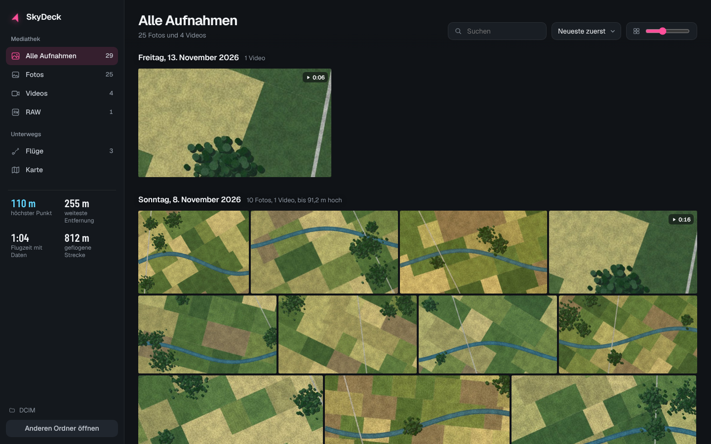
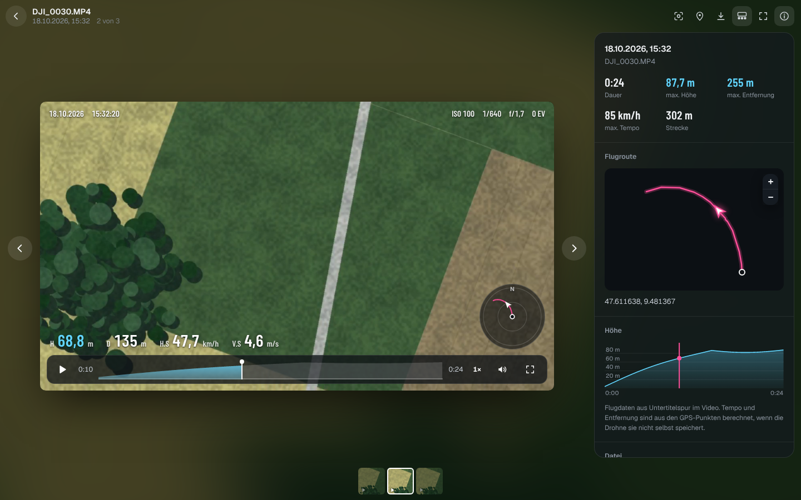
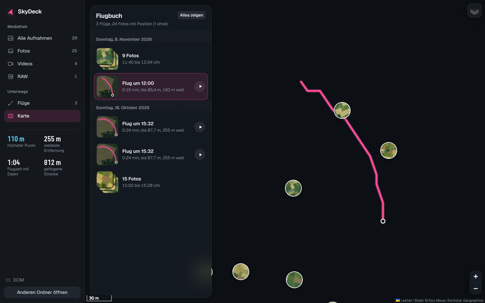

# SkyDeck

Ein Viewer für Fotos, Videos und Flugdaten von DJI-Drohnen. Er läuft komplett im Browser, und deine Dateien werden nirgendwo hochgeladen.

## Was er kann

- **Mediathek**: alle Fotos und Videos im Blocksatz wie in einem Foto-Programm, nach Tagen gruppiert. Seitenleiste mit Fotos, Videos, RAW, Flügen und Karte; Suche, Sortierung (auch nach Flughöhe) und Vorschaugröße.
- **Foto-Ansicht**: Vollbild mit Zoom (Mausrad oder Doppelklick), Filmstreifen und Blättern mit den Pfeiltasten. Daneben stehen Höhe über dem Startpunkt, ISO, Belichtung, Blende, Aufnahmeort auf einer Mini-Karte und alle Metadaten.
- **Video mit Flugdaten**: eigener Player, dessen Zeitleiste gleichzeitig das Höhenprofil ist. Höhe (H), Entfernung (D), Tempo (H.S) und Steigrate (V.S) laufen live im Bild mit, dazu ein kleines Radar mit der Route. Daneben eine Karte, auf der die Drohne mitfliegt.
- **Flüge**: jeder Flug als Karte mit Routen-Skizze, Höhenverlauf und den wichtigsten Werten.
- **Karte mit Flugbuch**: alle Fotos mit Vorschaubild an ihrem Aufnahmeort und alle Flugrouten. Links steht das Flugbuch: Beim Durchscrollen fliegt die Karte zu jedem vergangenen Flug und hebt ihn hervor.
- **RAW**: Wenn neben einem JPG eine DNG-Datei mit gleichem Namen liegt, wird sie erkannt und kann gespeichert werden.

| Foto | Video mit Flugdaten |
|---|---|
|  |  |
| **Flüge** | **Karte** |
|  |  |

*Die Screenshots zeigen erzeugte Testdaten, keine echten Drohnenaufnahmen.*

## Kostenlos online stellen (GitHub Pages)

SkyDeck braucht keinen Server, deshalb reicht GitHub Pages. Danach aktualisiert sich die Seite bei jedem neuen Commit von selbst.

1. Das Repo muss **öffentlich** sein. Mit einem kostenlosen GitHub-Konto gibt es Pages nur für öffentliche Repos; für private Repos braucht man ein bezahltes Konto (z. B. GitHub Pro).
2. Im Repo auf **Settings → Pages** gehen.
3. Bei **Source** „Deploy from a branch“ wählen, dann Branch **main** und Ordner **/ (root)**, und **Save** drücken.
4. Nach ein bis zwei Minuten steht oben die Adresse, z. B. `https://deinname.github.io/skydeck/`.

Online steht dann nur das Programm. Deine Fotos und Videos werden auch auf der Online-Version nicht hochgeladen, sondern nur in deinem Browser gelesen.

## Benutzen

**Online:** Wenn GitHub Pages eingeschaltet ist (siehe oben), öffnest du einfach die Seite und klickst auf **Ordner öffnen**.

**Offline:** `index.html` herunterladen und im Browser öffnen. Für die Kartenbilder brauchst du trotzdem Internet.

Wähle dann den Ordner von der SD-Karte (meist `DCIM`) oder zieh ihn einfach ins Fenster.

### Tastenkürzel im Betrachter

| Taste | Aktion |
|---|---|
| ← → | vorheriges / nächstes Bild |
| Umschalt + ← → | im Video 5 Sekunden springen |
| Leertaste | Video abspielen / anhalten |
| I | Infos ein/aus |
| S | Filmstreifen ein/aus |
| H | Flug-Anzeige im Video ein/aus |
| M | auf der Karte zeigen |
| F | Vollbild |
| + − 0 | Zoom rein / raus / zurücksetzen |
| Esc | schließen |

## Flugdaten für Videos

Höhe, Tempo und Route zu einem Video gibt es nur, wenn die Drohne sie mitgespeichert hat. Dafür in der DJI-App unter den Kamera-Einstellungen die **Video-Untertitel** einschalten. Die Drohne legt dann zu jedem Video eine `.SRT`-Datei mit gleichem Namen ab (z. B. `DJI_0042.MP4` und `DJI_0042.SRT`).

SkyDeck versteht mehrere SRT-Formate, die DJI über die Jahre benutzt hat:

- `[latitude: …] [longitude: …] [rel_alt: … abs_alt: …]` (z. B. Mini 2, Mini 3 Pro, Air 2S, Mavic 3)
- `GPS(lon,lat,…) BAROMETER:…` (z. B. Mavic Pro, Phantom 4)
- `GPS (…), D …m, H …m, H.S …m/s` (z. B. Phantom 4 Pro, Mavic 2)

Wenn keine `.SRT` daneben liegt, sucht SkyDeck eine Untertitelspur direkt in der MP4 (so speichern es manche neuere Modelle).

## Ehrlich gesagt: Grenzen

- **Getestet** wurde mit erzeugten Testdateien in den drei oben genannten SRT-Formaten und mit einer Standard-MP4-Untertitelspur, **nicht mit echten Dateien von jeder Drohne**. Wenn bei deiner Drohne etwas fehlt, eröffne gern ein Issue mit einer kurzen Beispiel-SRT.
- **Ruckelnde Videos:** 4K-Originale können auf schwächeren Rechnern im Browser ruckeln. Liegt eine `.LRF`-Datei daneben, schaltet der Knopf **HD/SD** im Player auf diese kleinere Vorschau-Datei um.
- **H.265-Videos (HEVC)** kann nicht jeder Browser abspielen. Chrome und Edge schaffen das meist nur, wenn der Rechner H.265 per Hardware unterstützt; Safari auf dem Mac kann es in der Regel. Liegt eine `.LRF`-Vorschaudatei daneben, spielt SkyDeck stattdessen diese ab.
- **DNG-Dateien** kann ein Browser nicht direkt anzeigen. Liegt kein JPG daneben, versucht SkyDeck die in der DNG eingebettete Vorschau zu zeigen. Mit echten DJI-DNGs ist das nicht getestet.
- **Flug-Logs** aus der DJI-App (`DJIFlightRecord_….txt`) werden nicht gelesen. Neuere sind verschlüsselt.
- Tempo und Entfernung werden aus den GPS-Punkten berechnet, wenn die Drohne sie nicht selbst speichert. Das sind dann Näherungswerte.
- Der Drohnenname (z. B. „DJI Mini 3 Pro“) wird nur für Kameramodelle angezeigt, deren Zuordnung sicher ist. Sonst steht nur der Modellcode da (z. B. `FC8482`).

## Technik

Die ganze App steckt in einer einzigen Datei, `index.html`: HTML, CSS, JavaScript, Schriften und Bibliotheken sind eingebettet. Es gibt keinen Build-Schritt und keinen Server.

Eingebettete Bibliotheken (Lizenztexte in `THIRD-PARTY-LICENSES.txt`):

- [Leaflet](https://leafletjs.com) und [Leaflet.markercluster](https://github.com/Leaflet/Leaflet.markercluster) für die Karten (BSD-2 / MIT)
- [exifr](https://github.com/MikeKovarik/exifr) zum Lesen von EXIF, GPS und den DJI-XMP-Daten (MIT)
- Schriften [Geist](https://github.com/vercel/geist-font) und [Barlow Condensed](https://github.com/jpt/barlow) (SIL Open Font License)

Kartenbilder: Satellit von Esri, Straßenkarte von OpenStreetMap, dunkle Karte von CARTO.

## Lizenz

MIT, siehe [LICENSE](LICENSE). Kein offizielles DJI-Produkt; DJI ist eine Marke von SZ DJI Technology Co., Ltd.
